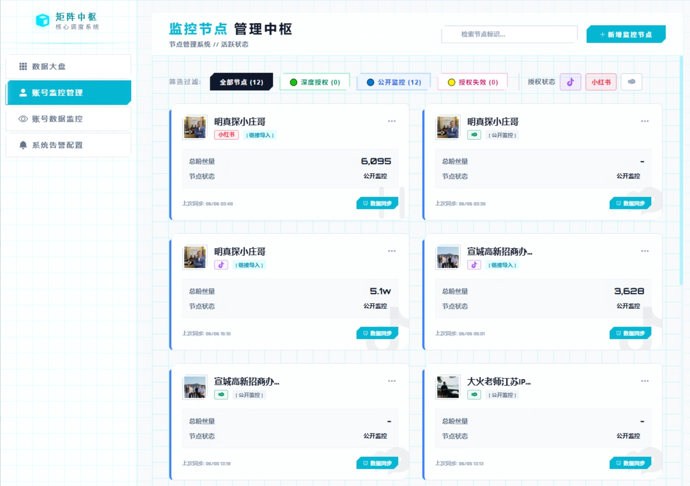
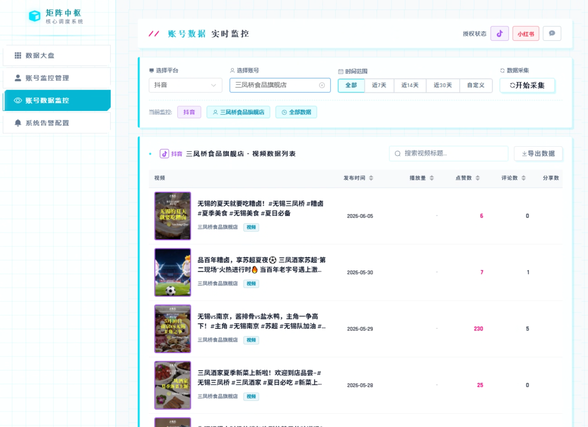
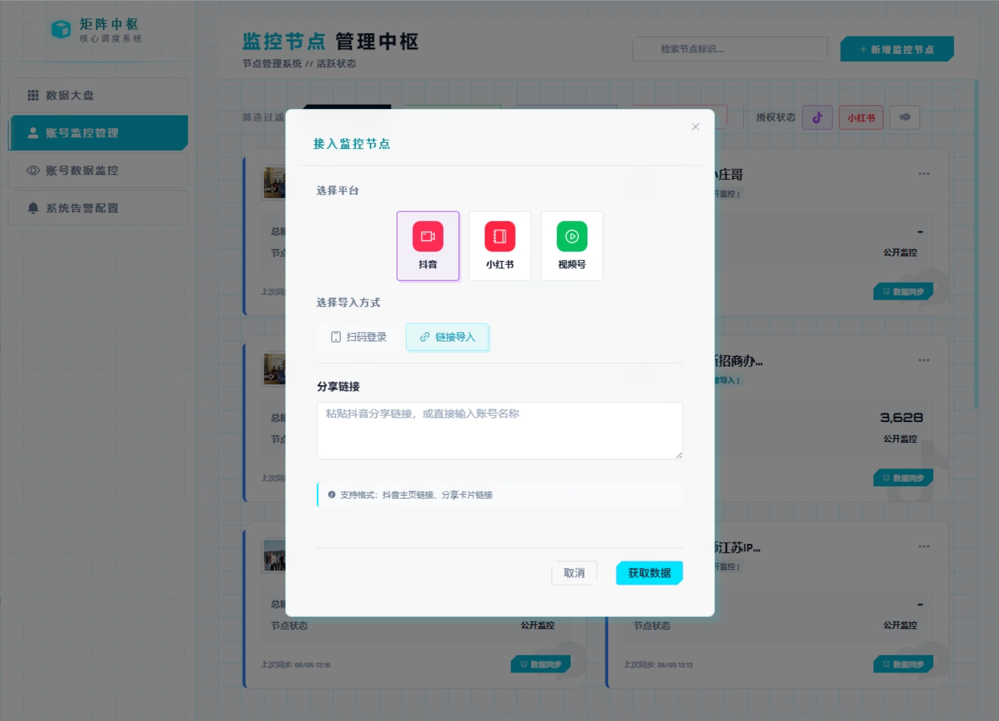

# 社交媒体监控系统

## 界面预览

### 监控节点管理



### 账号数据实时监控



### 接入监控节点



项目名称：`social-media-monitor`

中文名称：抖音、视频号、小红书监测

当前版本：`V1.3.0`

一个面向 Windows 的社交媒体账号与内容监控系统，支持接入抖音、小红书和视频号账号，采集账号资料及视频/笔记数据，并通过可视化后台统一查看、筛选和分析。

## 功能概览

- **多平台账号接入**：支持抖音、小红书、视频号。
- **扫码授权登录**：支持为需要登录权限的平台生成二维码并轮询登录状态。
- **公开账号监控**：可通过主页链接、分享链接或账号名称导入公开账号。
- **账号管理**：查看账号资料、平台、粉丝数、获赞数、同步时间和授权状态。
- **内容采集**：采集视频/笔记标题、封面、链接、发布时间、播放、点赞、评论、分享、收藏等数据。
- **批量同步**：支持按平台、账号和日期范围批量采集，并带有并发限制、重试和进度展示。
- **数据看板**：展示账号数、内容数、互动数据、平台分布和趋势统计。
- **内容检索**：按平台、账号、关键词、时间范围筛选和分页查看内容。
- **告警管理**：展示 Cookie 失效、采集失败、限流等监控告警。
- **视频号桌面采集**：可通过本地代理和桌面微信辅助采集视频号数据。
- **生产部署**：后端可直接托管构建后的前端，支持使用 PostgreSQL 部署到 Ubuntu。

## 支持平台与采集方式

| 平台 | 公开监控 | 登录监控 | 额外要求 |
| --- | --- | --- | --- |
| 抖音 | 支持主页/分享链接 | 支持扫码授权 | 建议使用稳定网络，频繁请求可能触发风控 |
| 小红书 | 支持主页/分享链接/账号名称 | 支持扫码授权 | Cookie 失效或触发安全验证时需要重新授权或等待冷却 |
| 视频号 | 支持搜索和桌面微信辅助 | 支持微信扫码/桌面微信 | 需要安装并登录桌面微信；部分功能需要安装本地代理 CA 证书 |

> 平台页面结构、接口和风控策略可能变化，采集结果取决于平台当前可访问的数据及账号权限。

## 技术栈

- 前端：Vue 3、Vite、Vue Router、Pinia、Element Plus、ECharts、Axios
- 后端：Node.js、Express、node-postgres
- 浏览器自动化：Playwright、Puppeteer、puppeteer-extra、Stealth Plugin
- 数据库：PostgreSQL 17
- 辅助脚本：PowerShell、Python（视频号桌面微信自动化）

## 运行环境

### 必需环境

- Windows 10/11 或 Windows Server 2019+
- Node.js 22.21 或更新的受支持 LTS 版本
- npm
- PostgreSQL 17，或用 Docker Desktop 启动项目自带的 PostgreSQL 17.10
- Chrome/Chromium 浏览器

### 视频号功能额外环境

- 已安装并登录的桌面微信
- 管理员权限（用于安装视频号本地代理 CA 证书时使用）
- Python 3（仅在使用桌面微信自动化脚本时需要）

## 项目结构

```text
social-media-monitor/
├─ client/                 # Vue 前端
│  ├─ src/views/            # 数据看板、内容、账号、告警页面
│  └─ package.json
├─ server/                 # Express 后端和采集服务
│  ├─ src/routes/           # 账号、视频、统计、代理接口
│  ├─ src/*-scraper.js      # 各平台采集器
│  └─ package.json
├─ database/                # PostgreSQL 表结构和历史 MySQL 脚本
├─ scripts/                 # 数据导出等辅助脚本
├─ start-local.bat          # 本地开发启动入口
├─ start-production.bat     # 生产模式启动入口
├─ package-release.ps1       # 构建并生成发布压缩包
└─ .env.example              # 环境变量模板
```

## 快速开始

### 1. 获取项目

```bash
git clone <your-repository-url>
cd social-media-monitor
```

### 2. 安装依赖

```powershell
cd server
npm ci

cd ..\client
npm ci
```

首次使用浏览器自动化功能时，建议安装 Playwright Chromium：

```powershell
cd ..\server
npx playwright install chromium
```

### 3. 启动本地 PostgreSQL

将项目根目录的 `.env.example` 复制为 `.env`，设置 `DB_PASSWORD`。然后启动 Docker Desktop，并执行：

```powershell
docker compose up -d --wait
```

本机数据库使用 PostgreSQL 17.10，默认监听 `127.0.0.1:55432`。数据库文件保存在 Compose 管理的数据卷。首次启动时自动创建应用表。

### 4. 配置应用

后端读取项目根目录的 `.env`，同名进程环境变量优先。常用配置包括 `DB_HOST`、`DB_PORT`、`DB_USER`、`DB_PASSWORD`、`DB_NAME` 和 `DB_TIMEZONE`。服务器部署见 [DEPLOYMENT.md](DEPLOYMENT.md)。

### 5. 启动本地开发环境

在项目根目录执行：

```bat
start-local.bat
```

启动后按终端打印的地址访问。默认地址如下：

- 前端：<http://127.0.0.1:5173>
- 后端：<http://127.0.0.1:3000>
- 健康检查：<http://127.0.0.1:3000/health>

默认端口被占用时，脚本会选用后续的空闲端口，并让前端代理连接实际启动的后端。运行日志写入 `server/logs/`。

## 生产部署

### 方式一：直接构建并启动

```powershell
cd client
npm run build

cd ..\server
npm ci
npm start
```

构建产物存在时，后端会同时托管 `client/dist`，访问：

```text
http://127.0.0.1:3000
```

也可以在项目根目录执行：

```bat
start-production.bat
```

### 方式二：生成发布包

发布脚本会构建前端、复制后端和数据库文件，并生成 ZIP 包：

```powershell
powershell -ExecutionPolicy Bypass -File .\package-release.ps1
```

输出文件：

```text
release/social-media-monitor-postgresql.zip
```

解压后，按照 `DEPLOYMENT.md` 配置 PostgreSQL、环境变量和 Node.js 依赖即可启动。

## 常用后端接口

后端 API 前缀为 `/api`，主要接口包括：

| 模块 | 路径 | 用途 |
| --- | --- | --- |
| 账号 | `/api/accounts` | 账号列表、添加、修改、删除和同步 |
| 二维码 | `/api/accounts/qr-code/*` | 生成二维码、查询登录状态、确认登录 |
| 视频/笔记 | `/api/videos` | 内容列表和新增 |
| 统计 | `/api/stats/*` | 概览、平台分布、趋势和排行 |
| 图片代理 | `/api/proxy/image` | 代理访问部分平台图片资源 |
| 视频号代理 | `/api/videohao-local-proxy/*` | 启停本地代理、桌面同步和状态查询 |

## 数据库说明

主要数据表包括：

- `platforms`：平台配置
- `accounts`：监控账号
- `videos`：采集到的视频/笔记
- `sync_logs`：同步任务日志
- `alerts`：系统告警
- `daily_stats`：每日统计数据

后端启动时检查 PostgreSQL 连接和应用表。运行中连接中断时，健康检查返回 HTTP 503。

## 安全与合规说明

- Cookie、登录状态和代理证书属于敏感信息，请勿提交到 GitHub。
- 不要把真实的 `.env`、账号 Cookie、二维码、运行日志或数据库备份 提交到公开仓库。
- 请遵守抖音、小红书、微信视频号的服务条款、robots 规则和当地法律法规，仅采集你有权访问和使用的数据。
- 采集频率应保持合理，避免对平台服务造成不必要压力。

## 故障排查

### 页面无法打开

确认前端依赖已安装，重新执行 `start-local.bat`，并使用终端打印的前端地址。

### 后端提示数据库连接失败

检查 PostgreSQL 是否启动，确认 `DB_HOST`、`DB_PORT`、`DB_USER`、`DB_PASSWORD` 和 `DB_NAME`。访问终端打印的后端地址下的 `/health` 检查连接状态。

### 采集失败或 Cookie 失效

重新扫码授权，降低采集频率，并确认浏览器可以正常访问对应平台。小红书触发安全验证时需要等待冷却时间后再试。

### 视频号采集失败

确认桌面微信已经登录且保持打开；如提示证书或代理问题，请使用管理员权限运行：

```bat
install-videohao-ca-admin.bat
```

## 许可证

当前仓库未指定开源许可证。如需公开发布，请根据项目用途补充 `LICENSE` 文件，并明确第三方平台数据使用边界。
